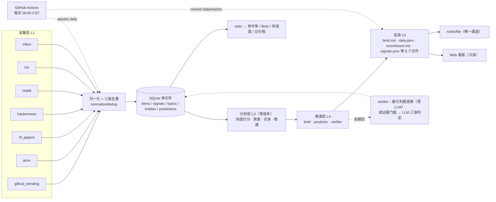

# aipulse · AI 脉搏

[](https://github.com/tochikoma777/aipulse/actions/workflows/ci.yml)
[](https://github.com/tochikoma777/aipulse/actions/workflows/daily.yml)
[](LICENSE)


> 每天自动采集 AI 领域热点，不只做整理——**还给出可证伪的预言，到期自动验证，并把成绩单公开贴在这里。**

**状态**：全部阶段已交付并实跑验证（最新 tag `t9`）。系统每天自动产出日报与记分板（Actions `daily`），每月 1 日自动产出趋势长文与多角色辩论（`monthly`）。完整变更见 [CHANGELOG](CHANGELOG.md)。

---

## 看板


`aipulse serve` 起的就是这份只读看板：今日简报、主编点评、到期验证与分板块条目。截图取自 2026-10-17 的真实日报，纯服务端渲染，htmx 已内置、无外部依赖。

## 不一样的地方

多数日报只把今天的热点整理给你看，信息是死的——没人知道它的判断准不准。aipulse 多做了一件难得多的事：

- **每天产出可证伪的预言**。措辞含糊（"可能"、"值得关注"）在生成阶段被硬拦截，每条必须写明判据与到期日。
- **到期自动判定**。带量化判据的查表即判，零 API 成本；语义型预言先过证据门槛，再交给模型判 `hit / partial / miss`。
- **成绩公开**。命中率、Brier Score、置信度校准曲线全部贴在下面的 [★ 预言记分板](#-预言记分板)，跑一天就多一天的样本。
- **口径写死在代码里**：`pending` 与 `unverifiable` 不计入分母，`partial` 按 0.5 计，低置信区间 `[0.05, 0.5)` 必须统计。`unverifiable` 只由系统的证据门槛产生，模型不得自己输出——否则它会变成逃避"落空"的软出口，记分板会系统性美化自己。

这是一个会给自己打分的系统。跑得越久，这份成绩单越有说服力。

## 快速开始

环境：WSL2 / Linux / macOS，Python 3.11+，[uv](https://docs.astral.sh/uv/)。**代码请放在 WSL 原生文件系统**（`/mnt/c/` 下 I/O 极慢、SQLite 锁异常、git 行为诡异）。

```bash
git clone https://github.com/tochikoma777/aipulse && cd aipulse
uv sync

uv run aipulse init                     # 建库 + 目录骨架 + 生成 .env
uv run aipulse doctor                   # 体检：Python / key / 代理 / 磁盘 / 数据库 / 各源连通性
uv run aipulse daily --skip-llm         # 跑一整天：collect → analyze → brief → render（零花费）
```

产出落在 `data/reports/YYYY/MM/DD/`，一天一个目录、8 个文件：

| 文件 | 用途 |
|---|---|
| `brief.md` | 人读的日报 |
| `daily.json` | 机器读的结构化日报 |
| `meta.json` | 运行元数据（窗口 / 档位 / 花费） |
| `scoreboard.md` | ★ 预言记分板 |
| `verdicts.md` | 当日到期的验证结果 |
| `predictions.md` | 当日新生成的预言 + 证据对照 |
| `signals.json` | 指标快照与增速 |
| `source_runs.json` | 各源运行状态 |

开看板看结果：

```bash
uv run aipulse serve --port 8000        # → http://127.0.0.1:8000
```

想接上模型（可选，DeepSeek 兼容 OpenAI 协议）：

```bash
cp .env.example .env
# 编辑 .env：AIPULSE_LLM__API_KEY=sk-...   AIPULSE_LLM__BASE_URL=https://api.deepseek.com/v1
uv run aipulse daily                    # hybrid/full 档：自动生成预言 + 主编点评
```

### 一份真实日报长什么样

2026-10-24 的头条与总览（完整版见 [`data/reports/2026/10/24/brief.md`](data/reports/2026/10/24/brief.md)）：

> **AI 安全攻防同一天双向加速**：Cloudflare 把安全审计做成智能体技能，Claude-Red 把攻击方法论也做成技能，而瑞典政府选择直接禁用 ChatGPT 与 Claude。

- 🔐 **安全技能化** — Cloudflare 的 `security-audit-skill` 与 Claude-Red 同日上榜，攻防两端都被封装成可复用的 agent 技能，安全能力正在从"工具"变成"提示词资产"。
- 🤖 **模型迭代** — Kimi K3.1 Pro 携 Highspeed 版本冲上榜首，中国开源/半开源模型继续以发布节奏抢占注意力，而非以能力代差。
- 🏢 **合规退潮** — 瑞典政府办公室禁用 ChatGPT 与 Claude，与 OpenAI 宣布不再用实时互联网训练模型形成同向信号：数据边界正在收紧而非放宽。

## 三种跑法，选一种

这个项目**不需要服务器、不需要数据库服务、不需要 GitHub** 也能跑。

| 形态 | 适合谁 | 怎么用 | 需要什么 |
|---|---|---|---|
| **① 纯本地** | 只想在自己机器上跑，手动或定时都行 | `uv sync` → 在 `.env` 填 `AIPULSE_LLM__API_KEY` → `uv run aipulse daily` | 本机能访问外网（采集 + LLM） |
| **② Actions 托管** | 想让它每天自动跑、自己不用开机 | fork 仓库 → 配 `AIPULSE_LLM__API_KEY` secret → 开启 workflow | 什么都不用，云端每天 08:00（北京）自动跑，并把日报 commit 回仓库 |
| **③ 只读 · 知识库** | 只想**读**已有日报、写笔记、导出给 AI 用 | `uv sync` → `aipulse knowledge list` / `knowledge export` / `aipulse serve` | **不需要网络、不需要 API key** |

<details>
<summary><b>三个常见误解（建议先看）</b></summary>

1. **cron 只管"自动定时"，不管"能不能用"。** 没装 cron 不等于软件不能用——装 cron 只是让 `daily` 每天自己跑一次，不装就手动 `uv run aipulse daily`，功能一模一样。
2. **GitHub 只是托管代码的地方，不是运行依赖。** 克隆到本地、不 fork、不 push，照样能跑；Actions 只是"帮你每天自动跑"的可选通道。
3. **没有外网也不等于全都不能用。** 采集跑不了，但 `knowledge export` / `aipulse serve` / 渲染已有日报都不需要网络。

> 判断标准很简单：**要从网上抓新东西**（`collect` / `daily` / `trend` / `debate`）才需要外网 + API key；
> **只处理已经 commit 在 `data/reports/` 里的东西**（`knowledge` / `serve` / `selfcheck`）什么都不需要。

</details>

## 能力清单

**采集与分析**（纯代码，零 API 成本）

| 能力 | 说明 |
|---|---|
| 多源采集 | GitHub Trending / arXiv / HF Daily Papers / Hacker News / Reddit（r/LocalLLaMA + r/MachineLearning）/ RSS（英文主干 + 中文补充）+ `inbox` 手动投喂 |
| 归一化与去重 | URL 规范化（`arxiv.org` 与 `hf.co/papers` 归一到同一篇论文）+ 三级去重（URL / 跨源键 / SimHash） |
| 热度打分 | 多维度对数加权 + 跨源加成 + 增速，权重全在 `configs/scoring.yaml` |
| 主题聚类 | jieba + TF-IDF + 余弦连通分量；仅标题源不参与聚类（避免 22 字摘要污染相似度矩阵） |
| 每日简报 | 头条 / 总览 / 主编点评 / 分板块条目 / 矛盾之处 / 被低估的条目 |

**推理与产出**

| 能力 | 说明 |
|---|---|
| **★ 预言系统** | 生成 + 手写 + 不可证伪拦截 → 到期双路径验证 → 命中率 / Brier / 校准度 / 5 维分组统计 |
| **★ 周度趋势长文** | `aipulse trend`：9 个跨期结构（热度迁移 / 共动 / 背离 / 替代对 / 涌现断档 / 持续性 / 来源份额 / 预言复盘 / 未发生预期）**先由代码算出来**，再分 7 段交给模型解释。采集失败日、源集合变更日会被自动排除，不会把数据缺陷写成趋势。产出双层：`weekly.md` 给人看（三句话 + 判断 + 份额表 + 折叠免责 + 文末溯源），`weekly.json` 给校验看 |
| **★ 自验证** | `aipulse selfcheck`：L1 硬判据 / L2 信息增量 / L3 跨期回检 / L4 校准追踪，默认读 `weekly.json` 机器层，纯离线零成本，结论写 `admission.json` 供下期收紧门槛 |
| **★ 多角色辩论** | `aipulse debate`：乐观 / 怀疑 / 工程 / 投资四方并行陈述 → 交叉质证 → 主持人收敛为"共识 / 关键分歧 / 可执行结论 / 置信度 / 什么证据会让我改变判断"。证据包 ≤15 条、每条 ≤60 字、绝不回显摘要原文。省略 `--topic` 时按争议度自动选题，依据逐条打印 |
| **★ 知识库** | 给日报条目写本地笔记与阅读状态；`knowledge export` 生成 `index.md` / `my-notes.md` / `topics/*.md`，可直接喂给任意 AI 工具 |
| Web 看板 | `aipulse serve`：今日简报 / 归档 / 记分板 + 校准曲线 / 主题演化 / 检索（**全站只读**） |
| 自动化 | Actions 每日 08:00（北京时间）跑一次并 commit 报告；本地 cron 作为备份；知识库导出由 `scripts/cron_knowledge.sh` 独立执行 |
| 零 API 也能用 | 三档模式，未配置 key 自动降级，采集 / 打分 / 聚类 / 手写预言 / 自动验证 / 统计全链路可用 |

## 命令速查

```bash
uv run aipulse --help                                   # 完整命令树

# 采集与处理
uv run aipulse collect --since 24h                      # 全部源（单源失败隔离，退出码恒为 0）
uv run aipulse collect --sources arxiv,hackernews --dry-run --json
uv run aipulse analyze --date today --json              # 打分 + 聚类 + 实体（纯算法，零花费）
uv run aipulse daily --since 24h --skip-llm             # 一条龙（off 档，零花费）
uv run aipulse daily --no-collect --skip-llm            # 只做分析 + 简报（离线开发常用）

# 预言（★ 核心）
uv run aipulse predict --date today --json              # 自动生成（需 API key）
uv run aipulse predict add --yes                        # 手写预言（缺参自动降级为交互式向导）
uv run aipulse predict list --status pending --json
uv run aipulse predict verify --due-date 2026-10-31     # 到期验证（量化判据零 LLM）
uv run aipulse predict review pred_xxxx --verdict hit --note "..."   # 人工兜底
uv run aipulse stats --predictions --markdown           # 打印记分板

# 趋势长文 / 自验证 / 辩论
uv run aipulse trend --range 7d                         # 人类版 Markdown 到 stdout
uv run aipulse trend                                    # 省略 --range → 按 pipeline.trend.interval 取上一个完整自然月
uv run aipulse trend --range 7d --segments structural_changes        # 只重跑某一段
uv run aipulse selfcheck                                # L1–L4 自验证（读 weekly.json，纯离线零成本）
uv run aipulse watchlist                                # 每日核对 watchlist 条目是否仍在榜（纯离线）
uv run aipulse debate --topic "Agent 类项目密集进榜：真实采用还是单日脉冲"
uv run aipulse debate                                   # 省略 --topic → 自动选题（争议度打分 + 时效守卫）
# 产物：data/reports/trend/<窗口末日>/{weekly.md, weekly.json, selfcheck.*, watchlist.json, calibration.json}
#       data/reports/debate/<窗口末日>/debate-<slug>.{md,json}

# 看板与运维
uv run aipulse serve --port 8000
uv run aipulse doctor --no-network --json

# 知识库（本地笔记 + Markdown 导出）
uv run aipulse knowledge items --query "agent"          # 列出可记笔记的条目
uv run aipulse knowledge note --url "<URL>" --note "..." # 按 URL 写笔记
uv run aipulse knowledge list                            # 查看笔记
uv run aipulse knowledge export                          # → data/knowledge/
```

## ★ 预言记分板

本节由 `aipulse stats --predictions --markdown` 生成后手工贴入（**请勿手改数字**）。`daily` 每天也会把同款 `scoreboard.md` 写进当日报告目录，最新一份见 [`data/reports/2026/10/24/scoreboard.md`](data/reports/2026/10/24/scoreboard.md)。

> 截至 **2026-10-24**，系统已累计 **69** 条预言，尚无到期判定结果。
> 具体成绩将在首批预言到期并验证后展示——**让时间说话**。

| 指标 | 值 |
|---|---|
| 命中率（`hit` 占比） | —（0/0） |
| 加权分（`verdict_score` 均值，`hit=1 / partial=0.5 / miss=0`） | — |
| Brier Score（`mean((confidence − outcome)²)`，越低越好；<0.20 优秀，0.25 ≈ 随机） | — |
| 命中 / 部分 / 落空 | 0 / 0 / 0 |
| 待验证（`pending`） | 69 |
| 分母 | 已验证的预言；`pending` 与 `unverifiable` **不计入** |

**置信度校准**（声称置信度 vs 实际命中率——最有说服力的部分）：

| 置信度区间 | 样本 | 平均置信度 | 实际命中率 |
|---|---|---|---|
| [0.05, 0.5) | 0 | — | — |
| [0.5, 0.6) | 0 | — | — |
| [0.6, 0.7) | 0 | — | — |
| [0.7, 0.8) | 0 | — | — |
| [0.8, 0.95] | 0 | — | — |

还有按 `category` / `horizon_days` / `origin`（human / llm）/ `model` / `prompt_version` 的分组命中率。`serve` 起来的 `/predictions` 页面会把它们画成一张校准曲线——点越贴近对角线，说明系统越清楚自己不知道什么。

手写预言（`origin=human`）与模型预言（`origin=llm`）在记分板上**完全同权**，因此可以直接对比"人 vs 机器"的校准度。

**增速只报可信的数字**：`Δstars / Δhour` 需要两次快照，间隔不足 `signals.min_velocity_window_hours`（默认 6 小时）时，系统会标 `insufficient` 并拒绝给出增速——手动重跑、调试连跑都不会污染数据。把"几分钟涨 3 star"换算成"日增 3000"是自欺；离谱数据比没有数据更伤可信度。

## 运行模式

| 档位 | LLM 调用 | 你能得到什么 |
|---|---|---|
| `off` | **零次** | 采集 / 打分 / 聚类 / **手写预言** / **自动验证量化判据** / **命中率与校准统计** |
| `hybrid` | 约 7 次/日 | `off` 全部 + 自动生成预言 + 主编点评 + **条目增强（只补缺失，复用缓存）** |
| `full`（默认） | 全部 | `off` + `hybrid` 全部 + **增强全刷（忽略条目缓存）** |

**没有 API key 也能用**：未配置时自动降级到 `off` 档，只提示一次，不报错退出。趋势长文 `trend` 与多角色辩论 `debate` 需要 API key，且按 `pipeline.{trend,debate}.trigger_mode` 触发（默认 `auto`，月度），不由 `daily` 带出。

## 工作原理



设计要点（完整版见 [`docs/AI_Pulse_设计方案.md`](docs/AI_Pulse_设计方案.md)）：

- **收敛出口**：所有网络请求只走 `utils/http.py::HttpClient`（限速 / 重试 / 缓存 / UA / 代理），所有 LLM 调用只走 `llm/base.py::LLMClient`，所有时间只走 `core/timeutil.py`（UTC 入库，展示转 `Asia/Shanghai`）。
- **单源失败隔离**：一个源挂掉不影响整条流水线，`aipulse collect` 退出码恒为 0。
- **`actions_only` 源分级**：本地因 DNS 污染访问不到的源（`reddit` / `hf_papers`）在本地跳过且不计失败，在 Actions 中正常采集。
- **报告即数据库**：Actions 无法持久化 SQLite，因此报告文件（含 `signals.json` 增速快照）commit 回仓库；DB 用 Actions cache 尽力恢复。
- **趋势由代码发现，不由模型发现**：跨期结构先算出来再交给模型解释。让模型自由挑选题材的做法已被证伪两次。

## 每天自动跑

`.github/workflows/daily.yml`：`cron: 0 0 * * *`（UTC 00:00 = 北京 08:00）+ 手动触发。选这个点是因为 AI 新闻高度美国中心——滚动 24h 窗口换算到美西是「前一日 17:00 → 当日 17:00」，刚好完整覆盖当日美国工作日；改到北京 07:00 只覆盖约 7 小时，改到 23:30 又会错过当日美西发布。

日报按**滚动 24h** 取数（不是自然日），所以会跨两个自然日——`meta.json` 的 `window` 与 `brief.md` 顶部都标了窗口起止。

```bash
gh workflow run daily.yml          # 手动跑一次
gh run list --workflow=daily.yml   # 看历史运行
gh secret set AIPULSE_LLM__API_KEY # 配 key；也可在仓库 Settings → Secrets 里加
```

档位在 `daily.yml` 的 workflow 环境变量里显式声明为 `AIPULSE_MODE: hybrid`（每天 2-3 次调用：预言生成 + 主编点评）。未配 key 时自动降级 `off` 档——**不配 key，记分板就只有手写预言**。

三条持久化对策（Actions 每次都是全新机器）：

1. **报告文件 commit 回仓库**——`data/reports/` 是公开的，文本即数据库；
2. **`actions/cache` 保存 `data/aipulse.db`**——key 每次 run 唯一 + `restore-keys` 前缀兜底，尽力而为；
3. **关键增速落 `signals.json`**——即使 cache 丢了，也能从历史报告回溯 star 增速。

本地 cron 备份见 [`scripts/cron_daily.sh`](scripts/cron_daily.sh) 顶部注释，一行 crontab 即可：

```
35 7 * * * /home/<you>/projects/aipulse/scripts/cron_daily.sh
```

## 数据源

| 源 | 环境 | 说明 |
|---|---|---|
| GitHub Trending / arXiv / Hacker News / RSS（8 个 feed） | `always` | 本地与 Actions 均可采 |
| HuggingFace Daily Papers / Reddit（r/LocalLLaMA + r/MachineLearning） | `actions_only` | 本地 DNS 污染，仅 Actions 环境采集 |
| `inbox` 手动投喂 | `always` | 往 `data/inbox/*.md` 每行写一条 URL |

每个源的端点、真实字段、限速与失效降级路径见 [`docs/数据源手册.md`](docs/数据源手册.md)；要加源请看 [`docs/新增数据源指南.md`](docs/新增数据源指南.md)——新 URL 必须先用 `scripts/probe_sources.py` 实测通过。**增删 RSS/Atom 源只需改 `configs/sources.yaml`，不用写代码。**

## 合规与数据声明

- 只存储**标题 + 摘要 + 公开指标**，不做全文转载，均标注来源与原链接。
- Reddit 仅使用公开 RSS，不存储用户身份信息。
- **不抓取微信公众号与 X（Twitter）**（无公开 API / 有版权与合规风险）：相关内容请用 `data/inbox/*.md` 手动投喂。
- 遵守各站 `robots.txt` 与 User-Agent 要求；请求带明确 UA 与限速。

## 开发

```bash
uv run pytest                     # 全量（598 条，无需网络、无需密钥）
uv run pytest "tests/unit/test_web.py::test_readonly_engine_rejects_writes" -q   # 单用例
uv run pytest -k "dedup or cluster" -q                    # 按关键字筛
uv run ruff check . && uv run ruff format --check . && uv run mypy src/aipulse
uv run pre-commit install         # 提交前：ruff --fix + ruff-format + mypy + pytest
```

目录结构：

```
.
├── src/aipulse/
│   ├── collectors/   7 个采集器 + registry（只 fetch：不写库、不去重、不调 LLM）
│   ├── normalize/    清洗 + 三级去重
│   ├── store/        SQLModel 表 + alembic 迁移（读写 / 只读两套 engine）
│   ├── analysis/     打分 / 聚类 / 实体 / 增速 / 跨期结构 / 统计（零 LLM）
│   ├── reasoning/    简报 / 预言生成与验证 / 趋势长文 / 辩论 / 自验证
│   ├── render/       报告渲染（brief.md / daily.json / scoreboard.md / weekly.md …）
│   ├── cli/          Typer 命令树
│   └── web/          只读看板（FastAPI + Jinja2，htmx 已内置）
├── prompts/          Jinja2 模板（prompt 不写在 .py 里，头部带 YAML front-matter）
├── configs/          default / sources / scoring / entities / criteria
├── data/reports/     每天一个目录，仓库里唯一公开的数据
└── tests/            unit + integration，全部无需网络与密钥
```

模块职责、硬性约定、踩过的坑都在 [`CODEBUDDY.md`](CODEBUDDY.md)；按阶段的执行日志见 [`docs/开发日志.md`](docs/开发日志.md)，踩坑合集见 [`docs/踩坑实录.md`](docs/踩坑实录.md)。欢迎贡献，见 [`CONTRIBUTING.md`](CONTRIBUTING.md)。

## 进度

| 阶段 | 核心产出 | 状态 |
|---|---|---|
| **M0** | 项目骨架 + 数据源探测（fixtures + 数据源手册 + `doctor`） | ✅ |
| **M1** | 6 个采集器 + inbox + 三级去重（含环境分级） | ✅ |
| **M2** | 热度打分 / 聚类 / 实体 + LLM 抽象 + 每日简报 | ✅ |
| **M3** | ★ 预言系统：可证伪生成 + 手写 + 到期验证 + 命中率 / Brier / 校准度 | ✅ |
| **M4** | Actions 自动化 + Web 看板 + 开源发布包装 | ✅ |
| **M6a** | 简报格式规范化 + 快照型源修复 + predict 截断修复 | ✅ |
| **P0** | star 追踪：★ 总数 / 增量 + 增速榜 + `source_runs.json` | ✅ |
| **M6b** | 日报条目「为什么重要 / 立场」全覆盖 + 中文要点 | ✅ tag `m6b` |
| **M6c** | 知识库：本地笔记 + 阅读状态 + Markdown 导出 | ✅ tag `m6c` |
| **M5** | 周期趋势长文（S1–S3）+ 多角色辩论（S4）+ 产物可读化（S5） | ✅ tag `m5` |
| **T9** | trend / debate 自动触发（日历月 + 退出码分级 + watchlist 日核对） | ✅ tag `t9` |

## License

[MIT](LICENSE)
