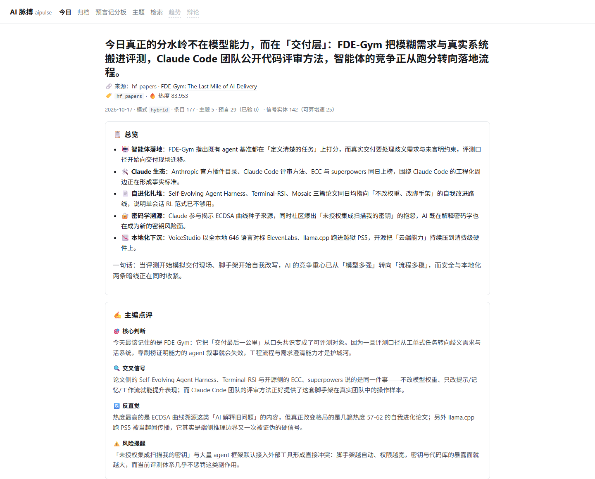
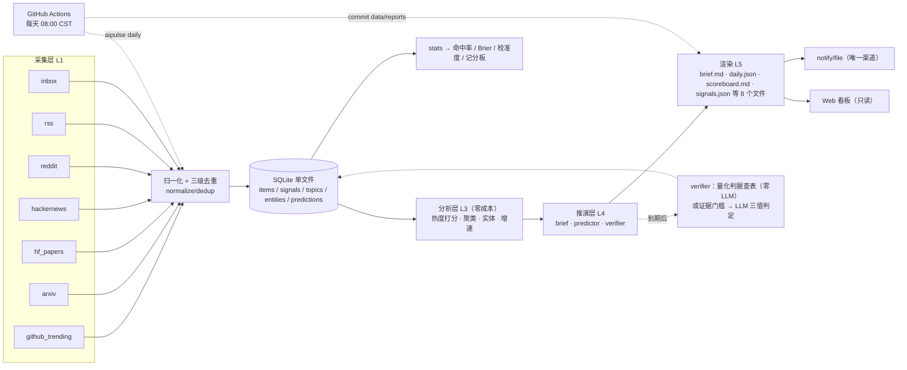

# aipulse · AI 脉搏

[](https://github.com/tochikoma777/aipulse/actions/workflows/ci.yml)
[](https://github.com/tochikoma777/aipulse/actions/workflows/daily.yml)
[](LICENSE)


> **每日自动采集 AI 领域热点，不只整理，还给出可回测的推演与预言。**

> ✅ **状态**：M0–M4 已完成，**M6a（简报格式 + 快照源修复 + predict 截断修复）、P0 star 追踪、M6b（条目 why/stance 全覆盖 + 中文要点）、M6c（知识库：本地笔记 + Markdown 导出）均已落地**——**系统每天自动跑**（Actions 定时流水线），产出日报 + **预言记分板**。
> M5（周期趋势长文 + 多角色辩论）待做。历史报告见 [`data/reports/`](data/reports/)。
>
> 完整变更见 [CHANGELOG](CHANGELOG.md) · 开发踩坑见 [踩坑实录](docs/踩坑实录.md)

## 为什么不是又一个 AI 日报

大多数"AI 日报"只做一件事：把今天的热点整理给你看。信息是死的——**没人知道它的判断准不准**。

aipulse 多做了一件难得多的事：**每天给出 3-5 条可证伪的预言，到期自动验证，并把命中率、Brier Score、置信度校准度公开贴在 README 上。**

- 预言必须**可证伪**：含糊措辞（"可能"、"值得关注"）会在生成阶段被硬拦截；每条预言都必须带判据。
- 到期**自动判定**：带量化判据的预言查表即判（**零 API 成本**）；语义型预言走证据门槛后交给 LLM 判 `hit/partial/miss`。
- **"无法验证"只由系统证据门槛产生**，LLM 不得输出——否则它就成了逃避"落空"的软出口，记分板会系统性美化自己。
- 分母口径写进代码：`pending` 与 `unverifiable` **不计入**命中率与 Brier，低置信区间 `[0.05, 0.5)` 也**必须**统计（丢掉低置信样本会让校准曲线虚高）。

**一句话**：这是一个会给自己打分的系统。跑得越久，这份成绩单越有说服力——这就是它的复利。

## 能力清单

| 能力 | 说明 |
|---|---|
| 多源采集 | GitHub Trending / arXiv / HF Daily Papers / Hacker News / Reddit（r/LocalLLaMA + r/MachineLearning）/ RSS（英文主干 + 中文补充）+ `inbox` 手动投喂 |
| 归一化与去重 | URL 规范化（`arxiv.org` 与 `hf.co/papers` 归一到同一篇论文）+ 三级去重（URL / 跨源键 / SimHash） |
| 热度打分 | 多维度对数加权 + 跨源加成 + 增速（`signals` 表算 Δmetric/Δhour），权重全在 `configs/scoring.yaml` |
| 主题聚类 | jieba + TF-IDF + 余弦连通分量；仅标题源不参与聚类（避免 22 字摘要污染相似度矩阵） |
| 每日简报 | 头条 / 总览 / 主编点评 / 分板块条目 / 矛盾之处 / 被低估的条目 |
| **★ 预言系统** | 生成 + 手写 + 不可证伪拦截 → 到期验证（双路径）→ 命中率 / Brier / 校准度 / 5 维分组统计 |
| Web 看板 | `aipulse serve`：今日简报 / 归档 / **预言记分板 + 校准曲线** / 主题演化 / 检索（**只读**，htmx 已内置，无外部依赖） |
| 自动化 | GitHub Actions 每日 08:00（北京时间）跑一次（`hybrid` 档：自动生成预言 + 主编点评），报告 commit 回仓库；本地 cron 作为备份；知识库导出由 `scripts/cron_knowledge.sh` 独立执行（方案 E） |
| **★ 知识库** | 给日报条目写本地笔记 / 阅读状态；`knowledge export` 生成 `index.md` / `my-notes.md` / `topics/*.md`，可直接喂给任意 AI 工具。主库只读，笔记存独立 `data/user_data.db` |
| 零 API 也能用 | 三档模式，未配置 key 自动降级，**采集 / 打分 / 聚类 / 手写预言 / 自动验证 / 统计全链路可用** |

## 三档运行模式

| 档位 | LLM 调用 | 你能得到什么 |
|---|---|---|
| `off` | **零次** | 采集 / 打分 / 聚类 / **手写预言** / **自动验证量化判据** / **命中率与校准统计** |
| `hybrid` | 约 7 次/日 | off 全部 + 自动生成预言 + 主编点评 + **条目增强（只补缺失，复用缓存）** |
| `full`（默认） | 全部 | off + hybrid 全部 + **增强全刷（忽略条目缓存）**；多角色辩论与周期长文属 M5，尚未实现 |

**没有 API key 也能用**：未配置时自动降级到 `off` 档，只提示一次，不报错退出。
手写预言与模型生成的预言在记分板上**完全同权**——都进命中率、都进 Brier、都进校准曲线，因此还能对比"人 vs 机器"的校准度。

## 5 分钟快速开始

环境：WSL2 / Linux / macOS，Python 3.11+，[uv](https://docs.astral.sh/uv/)。
**代码必须放在 WSL 原生文件系统**（不要放 `/mnt/c/`：I/O 极慢、SQLite 锁异常、git 行为诡异）。

```bash
git clone https://github.com/tochikoma777/aipulse && cd aipulse
uv sync

uv run aipulse init                     # 建库 + 目录骨架 + .env
uv run aipulse doctor                   # 环境体检：Python / key / 代理 / 磁盘 / 数据库 / 各源连通性
uv run aipulse daily --skip-llm         # 采一整天：collect → analyze → brief → render（零花费）
```

产出在 `data/reports/YYYY/MM/DD/`，共 **8 个文件**：

- `brief.md`（人读）/ `daily.json`（机器读）/ `meta.json`（运行元数据）
- `scoreboard.md`（★ 记分板）/ `verdicts.md`（当日到期验证结果）
- `predictions.md`（当日新生成的预言 + 证据对照）
- `signals.json`（指标快照 + 增速）/ `source_runs.json`（各源运行状态）

看板：

```bash
uv run aipulse serve --port 8000        # → http://127.0.0.1:8000
```

想接上模型（可选，DeepSeek 兼容 OpenAI 协议）：

```bash
cp .env.example .env
# 编辑 .env：AIPULSE_LLM__API_KEY=sk-...   AIPULSE_LLM__BASE_URL=https://api.deepseek.com/v1
uv run aipulse daily                    # hybrid/full 档：自动生成预言 + 主编点评
```

## 看板预览

`aipulse serve` 打开的就是这份只读看板：今日简报、主编点评、到期验证与分板块条目（截图取自 2026-10-17 的真实日报）。



## ★ 预言记分板

记分板由 `aipulse stats --predictions --markdown` 生成后手工贴入本节（**请勿手改数字**），
`daily` 每天也会把 `scoreboard.md` 写进当日报告目录。最新数据见
[`data/reports/2026/10/17/scoreboard.md`](data/reports/2026/10/17/scoreboard.md)。

> 截至 **2026-10-17**，系统已累计 **34** 条预言，全部处于待验证状态（**0** 条已到期）。具体成绩将在首批预言到期并验证后展示——**让时间说话**。

下表是完整结构（当前尚无已验证样本，数据会自动填充）：

| 指标 | 值 |
|---|---|
| 命中率（hit 占比） | —（0/0） |
| 加权分（verdict_score 均值，`hit=1 / partial=0.5 / miss=0`） | — |
| Brier Score（`mean((confidence − outcome)²)`，越低越好，<0.20 优秀，0.25 ≈ 随机） | — |
| 命中 / 部分 / 落空 | 0 / 0 / 0 |
| 待验证（pending） | 34 |
| 分母 | 已验证的预言；`pending` 与 `unverifiable` **不计入** |

**置信度校准**（声称置信度 vs 实际命中率——最有说服力的部分）：

| 置信度区间 | 样本 | 平均置信度 | 实际命中率 |
|---|---|---|---|
| [0.05, 0.5) | 0 | — | — |
| [0.5, 0.6) | 0 | — | — |
| [0.6, 0.7) | 0 | — | — |
| [0.7, 0.8) | 0 | — | — |
| [0.8, 0.95] | 0 | — | — |

还有按 `category` / `horizon_days` / `origin`（human / llm）/ `model` / `prompt_version` 的分组命中率。
`serve` 起来的 `/predictions` 页面会把这些画成一张**校准曲线**（点越贴近对角线，系统越清楚自己不知道什么）。

**增速只报可信的数字**：`Δstars / Δhour` 需要两次快照，若间隔不足 `signals.min_velocity_window_hours`（默认 6 小时），
系统会标 `insufficient` 并**拒绝给出增速**——手动重跑、调试连跑都不会污染数据。
（把「几分钟涨 3 star」换算成「日增 3000」是自欺；离谱数据比没有数据更伤可信度。）

## 架构



设计要点（完整版见 [`docs/AI_Pulse_设计方案.md`](docs/AI_Pulse_设计方案.md)）：
- **所有网络请求**只走 `utils/http.py::HttpClient`（限速 / 重试 / 缓存 / UA / 代理）；**所有 LLM 调用**只走 `llm/base.py::LLMClient`；**所有时间**走 `core/timeutil.py`（UTC 入库，展示转 `Asia/Shanghai`）。
- **单源失败隔离**：一个源挂掉不影响流水线，`aipulse collect` 退出码恒为 0。
- **`actions_only` 源分级**：本地 WSL 因 DNS 污染访问不到的源（`reddit` / `hf_papers`）在本地跳过且**不计失败**，在 Actions 中正常采集。
- **报告即数据库**：Actions 无法持久化 SQLite，因此报告文件（含 `signals.json` 增速快照）commit 回仓库；DB 用 Actions cache 尽力恢复。

## 自动化（每天真的在跑）

`.github/workflows/daily.yml`：`cron: 0 0 * * *`（UTC 00:00 = 北京 08:00）+ 手动触发。
选这个点是因为 AI 新闻高度美国中心：滚动 24h 窗口换算到美西是「前一日 17:00 → 当日 17:00」，
刚好完整覆盖当日美国工作日；改到北京 07:00 会只覆盖约 7 小时，改到北京 23:30 又会错过当日美西发布。

日报按**滚动 24h** 取数（不是自然日），所以会跨两个自然日——`meta.json` 的 `window` 与 `brief.md` 顶部都标了窗口起止。

```bash
gh workflow run daily.yml          # 手动跑一次
gh run list --workflow=daily.yml   # 看历史运行
```

档位在 `daily.yml` 的 workflow 环境变量里显式声明：`AIPULSE_MODE: hybrid`（每天 2-3 次调用：预言生成 + 主编点评；`full` 档多出的逐条点评对记分板说服力没有帮助）。
需要配置 secret `AIPULSE_LLM__API_KEY` 才会生效，未配置时自动降级 `off` 档（**不配 key 记分板就只有手写预言**）：

```bash
gh secret set AIPULSE_LLM__API_KEY     # 粘贴 DeepSeek key；也可在仓库 Settings → Secrets 里加
```

三条持久化对策（Actions 每次都是全新的机器）：
1. **报告文件 commit 回仓库**——`data/reports/` 是公开的，文本即数据库；
2. **`actions/cache` 保存 `data/aipulse.db`**（key 每次 run 唯一 + `restore-keys` 前缀兜底）——尽力而为；
3. **关键增速落 `data/reports/.../signals.json`**——即使 cache 丢了，也能从历史报告追溯 star 增速。

本地 cron 备份（保证数据不断档）：见 [`scripts/cron_daily.sh`](scripts/cron_daily.sh) 顶部注释，一行 crontab 即可：

```
35 7 * * * /home/<you>/projects/aipulse/scripts/cron_daily.sh
```

## 常用命令

```bash
uv run aipulse --help

# 采集与处理
uv run aipulse collect --since 24h                      # 全部源（单源失败隔离，退出码恒为 0）
uv run aipulse collect --sources arxiv,hackernews --dry-run --json
uv run aipulse analyze --date today --json              # 打分 + 聚类 + 实体（纯算法，零花费）
uv run aipulse daily --since 24h --skip-llm             # 一条龙（off 档）
uv run aipulse daily --no-collect --skip-llm            # 只做分析 + 简报（离线开发常用）

# 预言（★ 核心）
uv run aipulse predict add --yes                        # 手写预言（缺参自动降级为交互式向导）
uv run aipulse predict --date today --json              # 自动生成（需 API key）
uv run aipulse predict list --status pending --json
uv run aipulse predict verify --due-date 2026-10-25     # 到期验证（量化判据零 LLM）
uv run aipulse predict review pred_xxxx --verdict hit --note "..."   # 人工兜底
uv run aipulse stats --predictions --markdown           # 记分板
uv run aipulse stats --predictions --out data/reports/scoreboard.md

# 看板与运维
uv run aipulse serve --port 8000
uv run aipulse doctor --no-network --json

# 知识库（本地笔记 + Markdown 导出）
uv run aipulse knowledge items --query "agent"          # 列出可记笔记的条目
uv run aipulse knowledge note --url "<URL>" --note "..." # 按 URL 写笔记
uv run aipulse knowledge list                            # 查看笔记
uv run aipulse knowledge export                          # → data/knowledge/
```

## 数据源

| 源 | 环境 | 说明 |
|---|---|---|
| GitHub Trending / arXiv / Hacker News / RSS | `always` | 本地与 Actions 均可采 |
| HuggingFace Daily Papers / Reddit r/LocalLLaMA | `actions_only` | 本地 DNS 污染，仅 Actions 环境采集 |
| `inbox` 手动投喂 | `always` | 往 `data/inbox/*.md` 每行写一条 URL |

每个源的端点、真实字段、限速与失效降级路径见 [`docs/数据源手册.md`](docs/数据源手册.md)；
要加源请看 [`docs/新增数据源指南.md`](docs/新增数据源指南.md)（新 URL 必须先用 `scripts/probe_sources.py` 实测通过）。

## 合规与数据声明

- 只存储**标题 + 摘要 + 公开指标**，**不做全文转载**，均标注来源与原链接。
- Reddit 仅使用公开 RSS，不存储用户身份信息。
- **不抓取微信公众号与 X（Twitter）**（无公开 API / 有版权与合规风险）：相关内容请用 `data/inbox/*.md` 手动投喂。
- 遵守各站 `robots.txt` 与 User-Agent 要求；Requests 带明确 UA 与限速。

## Roadmap

| 阶段 | 核心产出 | 状态 |
|---|---|---|
| **M0** | 项目骨架 + 数据源探测（fixtures + 数据源手册 + `doctor`） | ✅ |
| **M1** | 6 个采集器 + inbox + 三级去重（含环境分级） | ✅ |
| **M2** | 热度打分 / 聚类 / 实体 + LLM 抽象 + 每日简报 | ✅ |
| **M3** | ★ 预言系统：可证伪生成 + 手写 + 到期验证 + 命中率 / Brier / 校准度 | ✅ |
| **M4** | **Actions 自动化 + Web 看板 + 开源发布包装** | ✅ |
| **M6a** | 简报格式规范化 + 快照型源修复 + predict 截断修复 | ✅ |
| **P0** | star 追踪：★ 总数 / 增量 + 增速榜 + `source_runs.json` | ✅（Actions 实跑验证 2026-10-17） |
| **M6b** | 日报条目「为什么重要 / 立场」全覆盖 + 中文要点（`one_liner`） | ✅（tag `m6b`） |
| **M6c** | 知识库：本地笔记 + 阅读状态 + Markdown 导出 | ✅（tag `m6c`） |
| **M5** | 周期趋势长文 + 多角色辩论 | ⬜ 待做 |

## 开发

```bash
uv run pytest                     # 全量（无需网络、无需密钥）
uv run pytest "tests/unit/test_web.py::test_readonly_engine_rejects_writes" -q   # 单用例
uv run ruff check . && uv run ruff format --check . && uv run mypy src/aipulse
uv run pre-commit install         # 提交前：ruff --fix + ruff-format + mypy + pytest
```

开发约定、目录职责、踩过的坑都在 [`CODEBUDDY.md`](CODEBUDDY.md)；阶段日志见 [`docs/开发日志.md`](docs/开发日志.md)。
欢迎贡献，见 [`CONTRIBUTING.md`](CONTRIBUTING.md)。

## License

[MIT](LICENSE)
